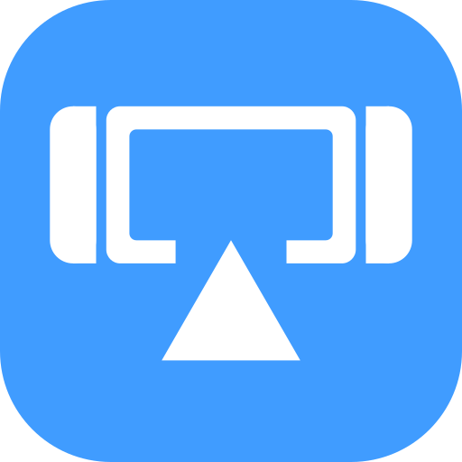

  

<h1 align="center">SwitchAirCast</h1>

  Turn your Nintendo Switch into an AirPlay receiver. Mirror your iPhone, iPad or Mac to the
  Switch, send YouTube videos to it, or play music through it — the same way you would with an
  Apple TV.

  <a href="../../releases/latest"><b>Download the latest release</b></a>

## What it can do

- **Screen mirroring** from iPhone, iPad and Mac, up to 1080p at 60 fps, decoded by the Switch's
  hardware video decoder.
- **Send videos instead of mirroring.** Tap the AirPlay button in the YouTube app (iPhone/iPad)
  or in Safari on a Mac and the Switch plays the video by itself. Your device becomes the remote,
  so you can lock it or use other apps meanwhile.
- **Music over AirPlay**, with the song title, artist, album, cover art and progress on screen,
  and volume control from your device.
- **Vertical mode** for portrait apps: turn the picture 90° and hold the console upright. It can
  also follow the console's motion sensor automatically.
- **Screen off** while music keeps playing (button Y, or automatically after a few minutes).
- **Black theme** for the OLED model (chosen automatically) and an **English / Spanish**
  interface that follows the console's language.

## What you need

- A Switch that can run homebrew (Atmosphère with the Homebrew Menu).
- The Switch and your iPhone, iPad or Mac on the same Wi-Fi network.

## Install

1. Download `SwitchAirCast.nro` from the [Releases](../../releases) page.
2. Copy it to the `/switch/` folder on the SD card.
3. Open the Homebrew Menu **through a game**: hold **R** while starting any game. Starting it
   from the Album also works, but the Switch then gives homebrew much less memory, which can make
   video playback fail or the app close.
4. Start **SwitchAirCast**. It shows the name it uses on the network (your console's nickname).

## Using it

**Mirror your screen**

- iPhone / iPad: open Control Center → **Screen Mirroring** → choose your Switch.
- Mac: Control Center → **Screen Mirroring** → choose your Switch.

**Send a video**

- iPhone / iPad: in the YouTube app, tap the cast/AirPlay button → **AirPlay & Bluetooth
  devices** → choose your Switch.
- Mac: in **Safari**, tap the AirPlay button on the YouTube video and choose your Switch.
  The first time, the Mac asks for a code: type the 4 digits shown on the Switch. After that it
  connects without asking. (Chrome has no AirPlay; use Safari.)

Pause, seek and stop from your device, or with the Switch buttons below.

**Play music:** choose the Switch as the AirPlay speaker in Music, Spotify, Control Center, etc.

### Buttons

| Button | What it does |
| --- | --- |
| **−** | Settings: language, theme, screen-off timer, vertical mode |
| **+** | Exit |
| **Y** | Turn the screen off (any button turns it back on) |
| **R** | While mirroring or playing a video: turn the picture (off → left → right) |
| **B** | Disconnect the device, or stop the video that is playing |
| **A** | Pause / play a video |
| **◀ / ▶** | Video: back / forward 10 seconds |
| **▲ / ▼** | Video: forward / back 1 minute |
| **X** | Show or hide technical info (resolution, frame rate, decoder) |

Touching any button during a cast shows a reminder that **−** opens the settings. Any button
also hides an AirPlay code you don't need.

The Switch does not dim or go to sleep while SwitchAirCast is open.

## Settings

The Settings menu (**−**) changes the most common options and saves them right away. All
options live in `/config/SwitchAirCast/config.ini` on the SD card; you can edit that file on a
computer (changes there apply the next time you start the app).

| Option | Default | Meaning |
| --- | --- | --- |
| `name` | console nickname | Name shown in the Screen Mirroring list |
| `language` | `auto` | `auto` (console language), `en` or `es` |
| `theme` | `auto` | `auto` (black on the OLED model), `dark` or `black` |
| `screen_off_minutes` | `5` | Turn the screen off after this many minutes of waiting or music (`0` = never) |
| `vertical_mode` | `off` | `off`, `auto` (motion sensor, handheld only), `left` or `right` |
| `width`, `height` | `1920`, `1080` | Picture size asked from your device (`1280` × `720` is lighter on Wi-Fi) |
| `max_fps` | `60` | Frame rate asked from your device |
| `audio` | `true` | Play sound on the Switch |
| `video_casting` | `true` | Accept videos sent from YouTube / Safari |
| `video_language` | `default` | Audio track for videos with several languages: `default` (the video's own), `system` (console language), or language codes such as `es:en` |
| `hw_decode` | `true` | Use the hardware video decoder (turn off only for troubleshooting) |
| `show_stats` | `false` | Start with the technical info visible |
| `port` | `7000` | Network port |
| `debug_log` | `false` | Write a very detailed log (for bug reports) |

## Troubleshooting

**The Switch doesn't appear in the list.** Make sure both are on the same Wi-Fi network (not a
guest network, which usually keeps devices apart). Wait a few seconds after starting the app, or
restart it. Some routers block devices from finding each other; look for "AP isolation" or
"client isolation" in the router settings and turn it off.

**The app closes or a video won't start.** Open the Homebrew Menu through a game (hold **R**
while starting one) rather than from the Album; see [Install](#install).

**The picture stutters.** Move closer to the router or set `width = 1280` and `height = 720`
in `config.ini`.

**Black screen in Netflix, Disney+, Apple TV+ and similar apps.** These apps block mirroring of
their videos, and their AirPlay streams are encrypted (FairPlay), so the Switch cannot play
them. YouTube works.

**A Mac asks for a code.** Type the 4 digits shown on the Switch. The code disappears by itself
after a minute, or press any button to hide it.

**Reporting a bug.** Please attach `log.txt` and `log-previous.txt` from
`/config/SwitchAirCast/` (the second one is the run before, useful after a crash) and, if the
app crashed, the newest file in `/atmosphere/crash_reports/`. Setting `debug_log = true` makes
the log much more detailed.

## Limitations

- Videos are played up to 1080p in H.264. YouTube's 4K (VP9/AV1) versions are skipped, and 4K
  (H.265) mirroring is not supported.
- Anyone on your network can mirror to the Switch while the app is open. Macs need the one-time
  code before sending videos; iPhones and iPads connect without one.

## For developers

Building, the desktop test setup and how the code is organised are described in
[docs/DEVELOPING.md](docs/DEVELOPING.md).

## License and credits

GPL-3.0-or-later (see [LICENSE](LICENSE)). The AirPlay protocol support comes from
[UxPlay](https://github.com/FDH2/UxPlay)'s library (with RPiPlay and the FairPlay
implementation it includes), ported to the Switch; video and audio playback use FFmpeg and SDL2.
libplist is LGPL-2.1 and llhttp is MIT.

SwitchAirCast is not affiliated with or endorsed by Apple or Nintendo. AirPlay, iPhone, iPad,
Mac and Safari are trademarks of Apple Inc. Nintendo Switch is a trademark of Nintendo.
